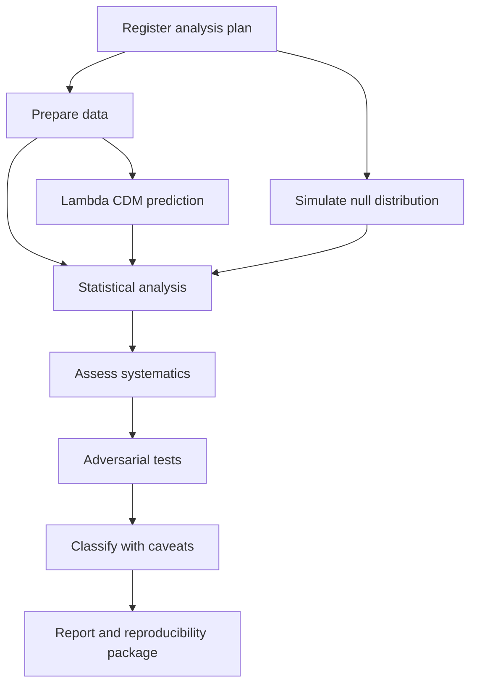

# Verification record: 10 November 2026

Fresh Python 3.12 environment on Linux. Package installed from this checkout with development dependencies. The initial installation failed because the runtime requested an absent clang compiler for pycosat; selecting installed GCC resolved it.

| Check | Outcome |
| --- | --- |
| python -m pytest tests -q | 247 passed; 1358 warnings; 24.59 seconds |
| ruff check cosmos tests | All checks passed |
| python -m cosmos version | Command completed successfully |

These are software checks with synthetic inputs, not new cosmological findings. Windows, macOS and Python 3.13/3.14 were not executed in this review. Dependencies were freshly resolved, not a frozen cross-platform lock. The repository's experiment outputs and research records were not changed.

Presentation follows the [PHANTOMTAPE OS standard](https://github.com/Nortaq-PlayNexus/Nortaq-PlayNexus/blob/portfolio/dynamic-repo-count-20261110/docs/PRESENTATION_STANDARD.md), while preserving this project's existing scientific framing.

## Pipeline structure

This diagram follows BaseExperiment.run in cosmos/experiments/__init__.py. The prediction and null simulation both feed the analysis; arrows show dependencies, not parallel execution.

EXP-001 uses synthetic data. This is a software architecture diagram, not evidence of an observed cosmological signal.
